**Project title:** Student Attendance Management System
**Technologies:** Python (Flask), HTML5, CSS3, JavaScript, CSV and JSON files
**Submitted by:** _(Student name / Register number)_
**Guide:** _(Faculty name)_
**Department / College:** _(Department, College, University)_
**Academic year:** 2026-27

# Certificate

This is to certify that the project entitled **"Student Attendance Management System"** is a bonafide work carried out by _(student name)_ in partial fulfilment of the requirements for the award of the degree of _(degree)_ during the academic year 2026-27.

Guide: ____________________  Head of Department: ____________________  External Examiner: ____________________

# Acknowledgement

I express my sincere gratitude to my project guide, the Head of the Department and the faculty members for their guidance and encouragement during this project, and to my friends and family for their support.

# 1. Abstract

Keeping attendance on paper registers is slow, error-prone and makes it hard to find out how regularly a student attends. This project presents a **web-based Student Attendance Management System** that replaces the paper register with a simple application. An administrator logs in, registers students, marks each student **Present** or **Absent** every day, and instantly obtains date-wise records, the **attendance percentage** of every student, dashboard statistics and **CSV reports** that can be opened in Excel.

The system is written in **Python using the Flask framework** with **HTML, CSS and JavaScript** for the interface. No database server is needed: all records are stored in local **CSV and JSON files** (`students.csv`, `attendance.csv`, `admin.json`), which keeps installation to two commands and lets the data be inspected with any spreadsheet. Passwords are stored as salted hashes, forms are protected against CSRF, input is validated on the client and the server, and files are written atomically so the data cannot be corrupted by a crash. The application was verified with 71 automated tests (all passing) and a browser-driven walkthrough that produced the screenshots in this report.

**Keywords:** attendance management, Flask, CSV storage, web application, reports, percentage calculation.

# 2. Objectives

1. Provide a secure **administrator login** so that only authorised staff can use the system.
2. Allow the administrator to **add, edit, delete and view** student details.
3. Allow **daily attendance** to be marked as Present or Absent quickly, even for large classes.
4. Provide **date-wise attendance records** with filters (date range, department, status, student).
5. **Calculate each student's attendance percentage** automatically and highlight students below the required limit (75 %).
6. Allow **searching** of students by name or register number.
7. **Export** students, attendance records and percentage reports to CSV.
8. Display **dashboard statistics** (totals, today's attendance, overall percentage, trend chart, low-attendance list).
9. **Validate** all input and handle errors with clear, friendly messages.
10. Offer a **clean, responsive interface** that works on desktop, tablet and phone and installs easily on Windows.

# 3. Existing System

In most colleges attendance is still recorded manually in paper registers or in separate spreadsheets maintained by individual teachers.

| Problem | Effect |
|---------|--------|
| Manual calculation of percentages | Time-consuming and prone to arithmetic mistakes |
| Paper registers can be lost, damaged or altered | No reliable history |
| Finding one student's records or one day's records means flipping pages | Slow reporting |
| No immediate list of students with shortage of attendance | Problems are noticed late (at exam time) |
| Reports must be re-typed to share | Duplicate effort and transcription errors |
| No access control | Anyone holding the register can change it |

Commercial student-information systems solve these problems but are expensive, need a database server and internet access, and are too heavy for a small department.

# 4. Proposed System

The proposed system is a lightweight web application that runs on one computer (or a lab server) and is used through a browser.

* **Simple data storage:** plain CSV/JSON files, readable in Excel and easy to back up (copy the `data` folder).
* **Secure access:** administrator login, hashed password, login lock-out, CSRF protection.
* **Fast marking:** one page lists the class; everyone starts as Present, only absentees are changed; live counters; mark-all buttons.
* **Automatic calculation:** `attendance % = present days / recorded days x 100`, shown per student, per period and per department.
* **Instant reports and exports:** filters on every report and one-click CSV download.
* **Easy installation:** a single `run_windows.bat` file installs Flask and starts the program.

**Advantages over the existing system:** accuracy, speed, searchable history, automatic warnings, no cost, no database administration.

# 5. System Requirements

## 5.1 Functional requirements

| ID | Requirement |
|----|-------------|
| FR1 | The administrator can log in, log out and change the password |
| FR2 | Unauthenticated users cannot open any page except the login page |
| FR3 | The administrator can add a student (register number, name, department, year, e-mail, phone) |
| FR4 | The administrator can edit, view and delete a student; deleting also removes the student's attendance |
| FR5 | The administrator can mark attendance for a date and department as Present or Absent |
| FR6 | Marking a date again updates the records instead of duplicating them |
| FR7 | The system shows date-wise records filtered by date range, department, status and search text |
| FR8 | The system shows each student's attendance percentage, optionally for a date range |
| FR9 | Students can be searched by name or register number |
| FR10 | Students, records and percentages can be exported as CSV |
| FR11 | The dashboard shows statistics and a chart |
| FR12 | All forms are validated and errors are reported clearly |

## 5.2 Non-functional requirements

| ID | Requirement |
|----|-------------|
| NFR1 | **Security** - hashed password, CSRF tokens, secure headers, no formula injection in exported CSV |
| NFR2 | **Usability** - responsive layout, clear messages, confirmation before deleting |
| NFR3 | **Reliability** - atomic file writes; damaged or locked files give a clear message instead of a crash |
| NFR4 | **Portability** - runs on Windows, macOS and Linux with Python 3.10+ |
| NFR5 | **Maintainability** - single readable `app.py`, separated templates/static files, automated tests |
| NFR6 | **Performance** - pages respond within a fraction of a second for thousands of records |

## 5.3 Hardware and software

* **Hardware:** any PC with 2 GB RAM and 500 MB free disk space.
* **Software:** Windows 10/11, Python 3.10 or newer, a modern web browser.
* **Python package:** Flask (see `requirements.txt`).

# 6. System Architecture

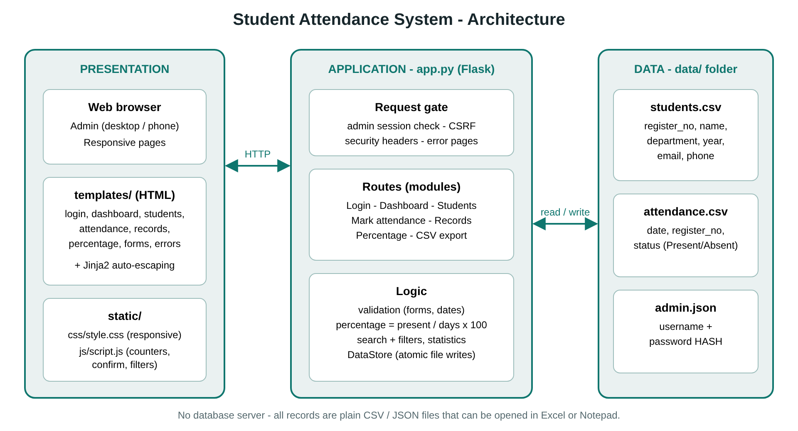

The system follows a three-layer design:

1. **Presentation layer** - HTML templates (Jinja2), the stylesheet `style.css` and `script.js`. The browser sends HTTP requests and receives HTML pages or CSV files.
2. **Application layer** - `app.py`. A *request gate* runs before every request: it checks the CSRF token and that the administrator is logged in. Route functions implement the modules; helper functions validate input, calculate percentages and build reports. Security headers and error pages are applied to every response.
3. **Data layer** - the `DataStore` class reads and writes the files in `data/`. A lock serialises writes, and each write goes to a temporary file that then replaces the real file (atomic), so a power failure cannot leave a half-written file.

## 6.1 Data files

**`students.csv`** - one row per student

| Column | Description |
|--------|-------------|
| register_no | Unique register number (case-insensitive), 2-20 characters |
| name | Full name |
| department | Department / course |
| year | Year of study (1-4) |
| email, phone | Optional contact details |
| created_at | Date and time of registration |

**`attendance.csv`** - one row per student per day

| Column | Description |
|--------|-------------|
| date | `YYYY-MM-DD` |
| register_no | Links to `students.csv` |
| status | `Present` or `Absent` |

**`admin.json`** - administrator `username` and `password_hash` (salted scrypt hash; the plain password is never stored).

## 6.2 Relationship

One student has many attendance rows (1 : N through `register_no`). Deleting a student deletes that student's rows.

## 6.3 Key algorithms

* **Attendance percentage:** `round(present * 100 / (present + absent), 1)`; if nothing is recorded the value is *N/A*.
* **Save attendance:** read all rows, remove the rows of the chosen date for the students being saved, add the new rows, sort by date and register number, write atomically.
* **Search:** case-insensitive partial match on name or register number combined with the department filter.
* **Dashboard trend:** the last seven marked dates, converted to an SVG bar chart by the template.

# 7. Modules

| # | Module | Description | Main routes |
|---|--------|-------------|-------------|
| 1 | Authentication | Login, logout, change password, brute-force lock-out, default-password warning | `/login`, `/logout`, `/change-password` |
| 2 | Student management | Add, edit, view, delete, search and filter students | `/students`, `/students/add`, `/students/<reg>`, `/students/<reg>/edit`, `/students/<reg>/delete` |
| 3 | Attendance marking | Mark or update a day's attendance for a department | `/attendance` |
| 4 | Records (date-wise) | Summary per date and detailed rows with filters | `/records` |
| 5 | Percentage | Per-student percentage, sort, "below 75 %" filter, date range | `/percentage` |
| 6 | Export | CSV of students, attendance records and percentages | `/export/students.csv`, `/export/attendance.csv`, `/export/percentage.csv` |
| 7 | Dashboard | Statistics, 7-day chart, department summary, low-attendance list | `/` |
| 8 | Storage and validation | CSV/JSON persistence, input validation, error handling | (internal) |

# 8. Implementation Details

* **Language / framework:** Python 3 with Flask; templates rendered by Jinja2 with automatic HTML escaping.
* **Sessions:** signed cookie, HTTP-only, SameSite=Lax, expires after 4 hours.
* **Passwords:** `generate_password_hash` / `check_password_hash` (scrypt, random salt). Five wrong attempts lock the login for five minutes.
* **CSRF:** a random token per session is embedded in every form and verified for every POST request.
* **Validation:** register number `[A-Za-z0-9_-]{2,20}`; name 2-60 letters/space/dot/apostrophe/hyphen; department required; year 1-4; optional e-mail and phone patterns; dates must be valid and not in the future; every student must have a status when attendance is saved.
* **CSV export:** UTF-8 with BOM so Excel shows accented names correctly; cells beginning with `=`, `+`, `-` or `@` are prefixed to stop spreadsheet formula injection.
* **Front-end:** `script.js` provides the mobile menu, delete confirmation, password show/hide, live present/absent counters, "All present / All absent" buttons, list filtering and client-side form checks. The interface uses CSS variables, grid/flexbox, a media query for phones (tables turn into cards) and automatic dark mode.
* **Error handling:** custom pages for 400/404/500, a specific message when a data file is locked by Excel or damaged, and no technical details shown to users.

# 9. Testing

## 9.1 Strategy

* **Automated tests** - 71 tests (`python -m unittest discover -s tests -v`) using Flask's test client; every test works in a temporary data folder.
* **Manual tests** - 40 test cases (see `TEST_CASES.md`) executed through the browser with the sample data.
* **Browser walkthrough** - an automated Chromium session (Playwright) logs in, searches, adds a student with invalid then valid data, marks attendance, applies filters, downloads a CSV and repeats key steps at phone width; it produced the screenshots in Section 10.

## 9.2 Summary of test cases

| ID | Test | Expected result | Result |
|----|------|-----------------|--------|
| T01 | Open any page without logging in | Redirect to login | Pass |
| T02 | Login with correct / wrong / empty credentials | Success / error message | Pass |
| T03 | Five wrong passwords | Account locked even for the right password | Pass |
| T04 | Logout (POST only), CSRF token missing | Session ended / 400 | Pass |
| T05 | Password stored as a hash in `admin.json` | Plain text absent | Pass |
| T06 | Change password with valid and invalid input | Updated / rejected with messages | Pass |
| T07 | Add student with valid data | Saved in `students.csv` and listed | Pass |
| T08 | Add student with invalid name, e-mail, phone, year, register number | Each rule produces a message | Pass |
| T09 | Duplicate register number (any letter case) | Rejected | Pass |
| T10 | Edit student; try to change register number | Updated; register number unchanged | Pass |
| T11 | Delete student | Student and attendance rows removed | Pass |
| T12 | Unknown student URL | 404 page | Pass |
| T13 | Search by name / register number / department; no result | Correct rows / "No matching students" | Pass |
| T14 | Mark attendance, save, mark again | Saved; second save updates, no duplicates | Pass |
| T15 | Future date, invalid date, unmarked student, invalid status | Rejected with message, nothing saved | Pass |
| T16 | Percentage 3 of 4 days, 1 of 3, 0 of 5, none recorded | 75.0, 33.3, 0.0, N/A | Pass |
| T17 | Percentage for a date range; "below 75 %"; sorting | Correct subset and order | Pass |
| T18 | Records filtered by range, status, department, search | Only matching rows | Pass |
| T19 | Invalid or reversed dates in filters | Error message, no crash | Pass |
| T20 | Export attendance (all, filtered, one student), percentage, students | Correct CSV content and headers | Pass |
| T21 | Export contains UTF-8 BOM; formula-like cell is neutralised | BOM present; cell prefixed with `'` | Pass |
| T22 | Dashboard with no data / with data / today not marked | Welcome page / correct statistics / "Not marked yet" | Pass |
| T23 | Missing, BOM-prefixed or blank-line CSV files | Handled without error | Pass |
| T24 | Damaged `admin.json` | Friendly error page, rest of the app works | Pass |
| T25 | Unexpected exception | Friendly 500 page, no internals shown | Pass |
| T26 | Security headers present | CSP, X-Frame-Options, nosniff | Pass |

**Result:** all 71 automated tests pass; all manual cases behaved as expected.

# 10. Results and Screenshots

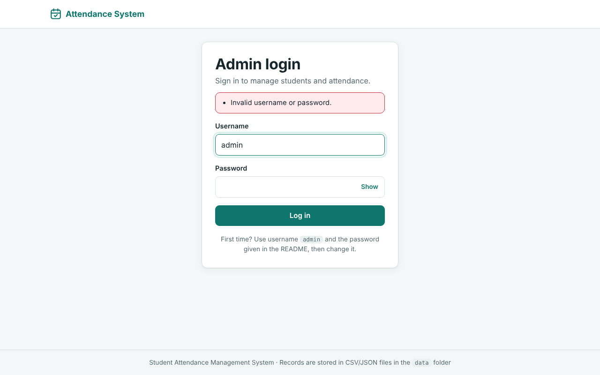

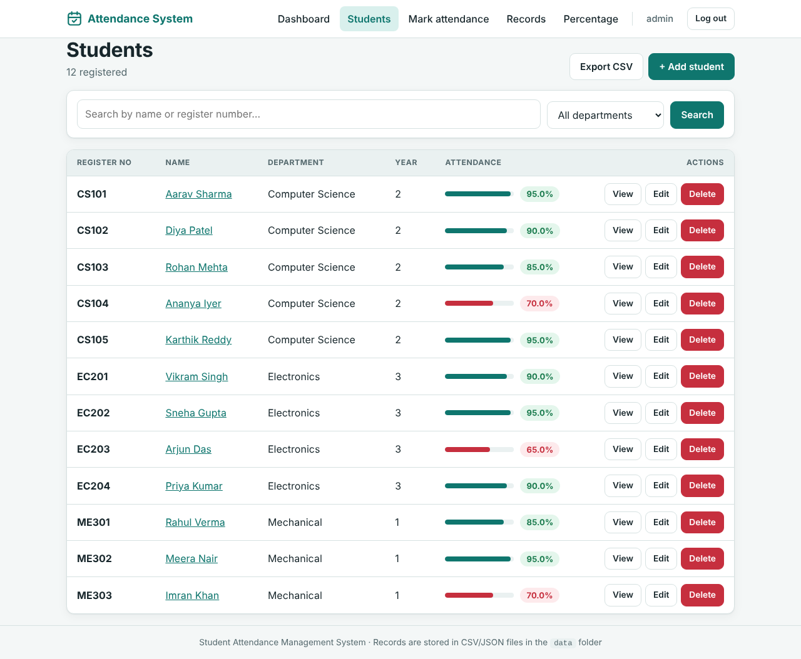

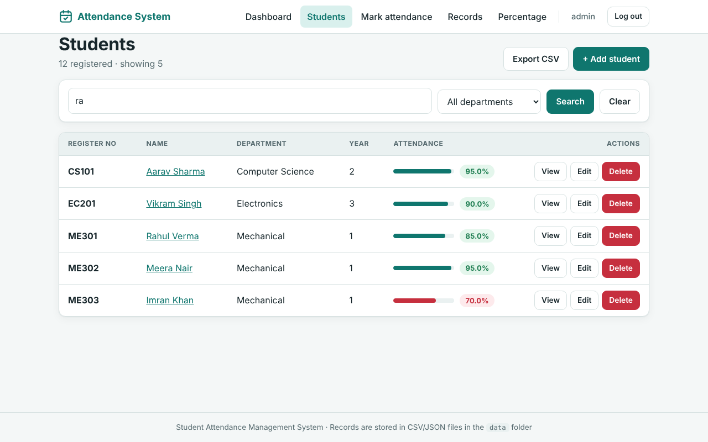

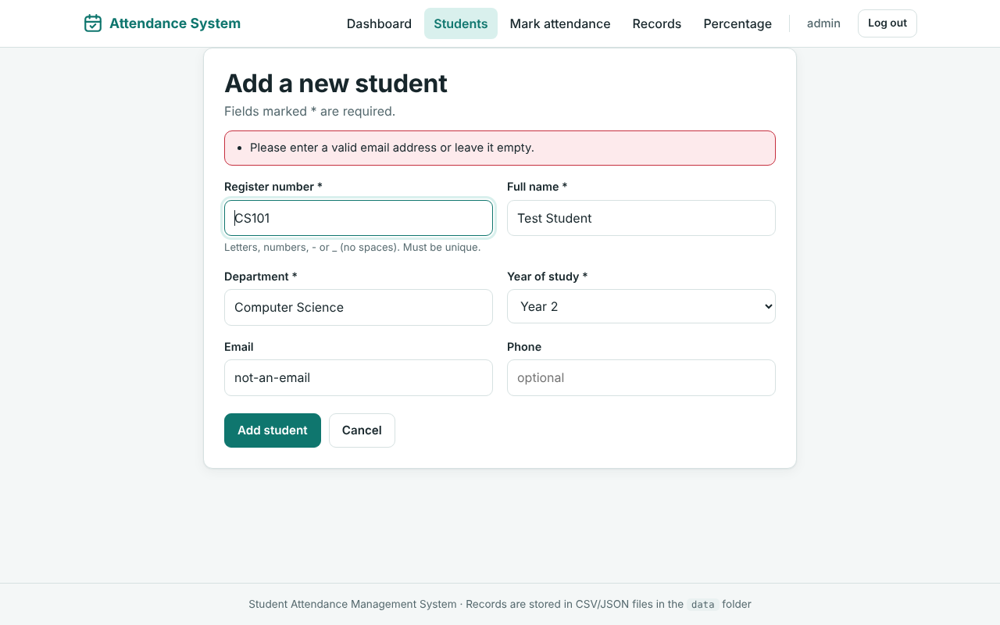

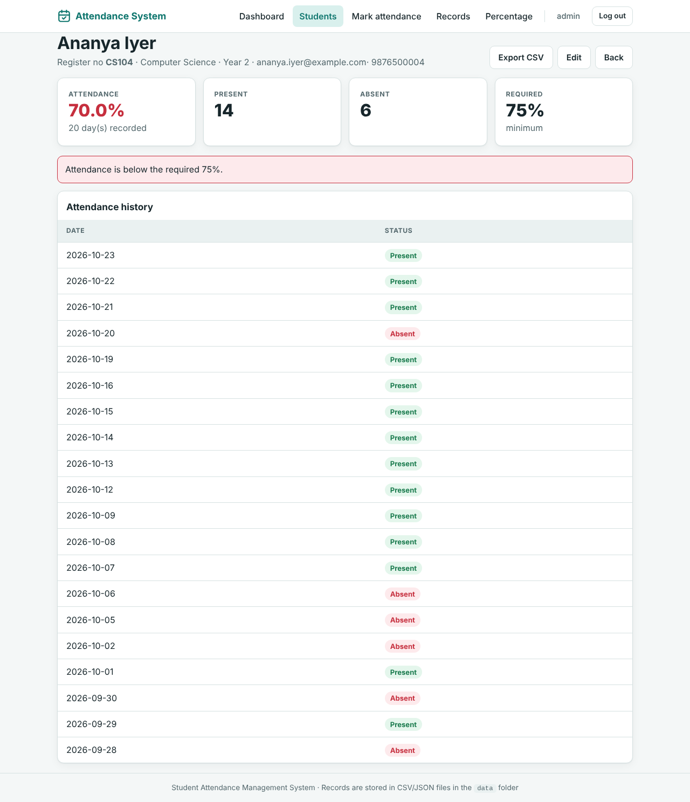

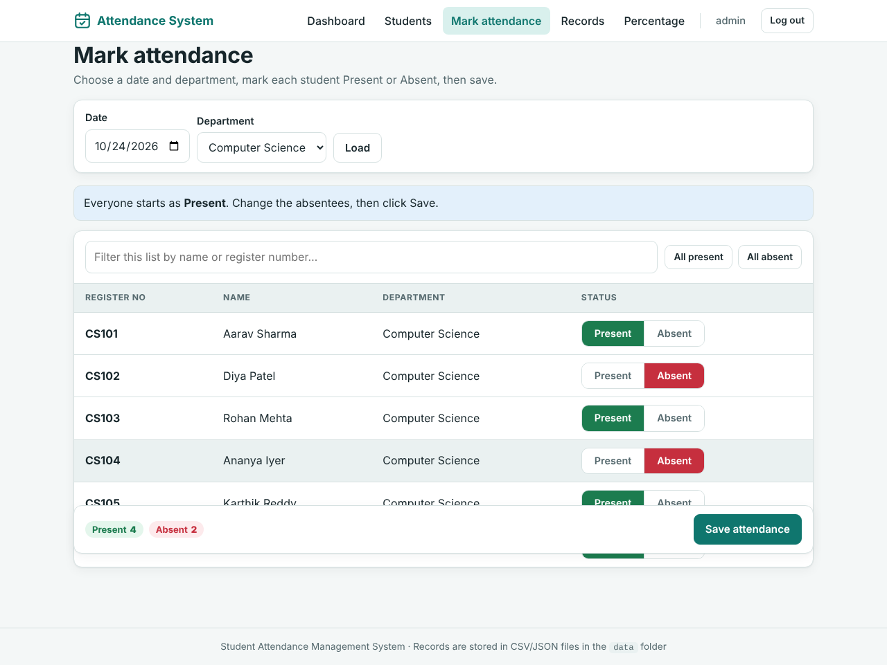

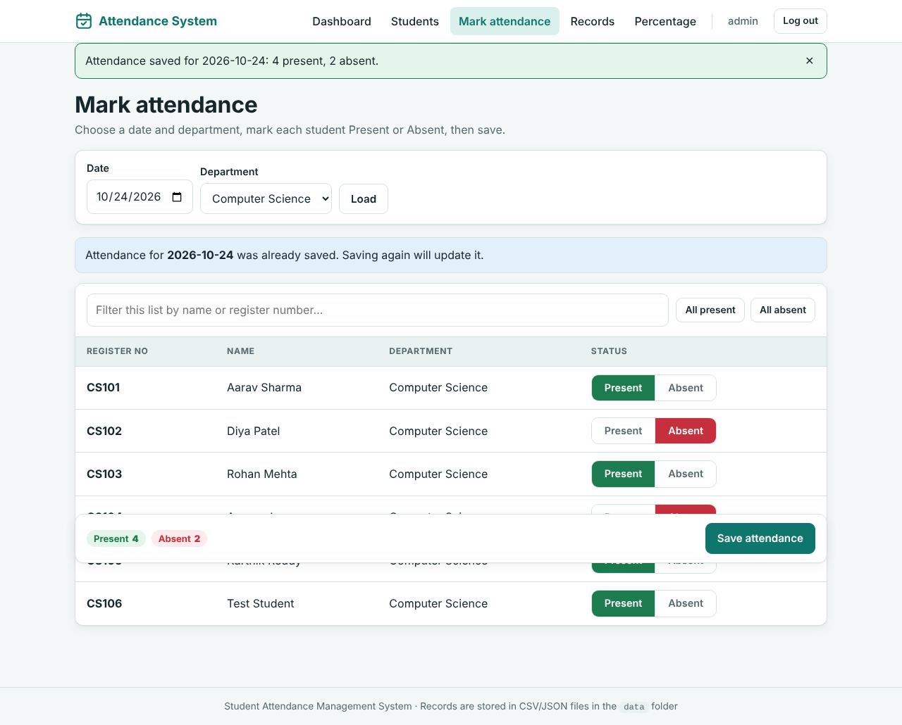

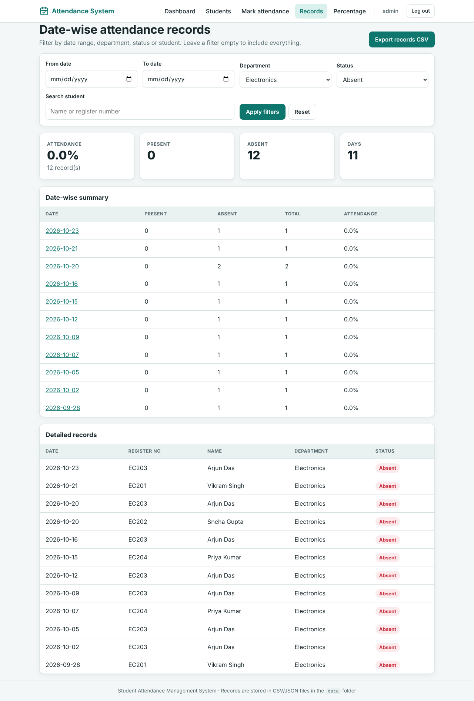

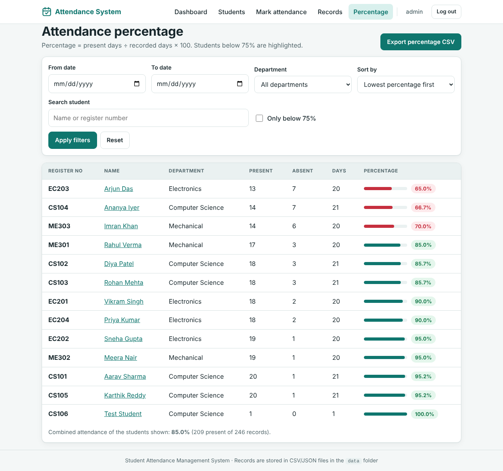

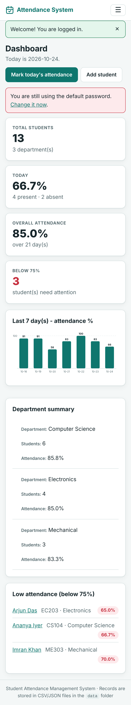

# 11. Advantages

* Works without any database software - only Python and Flask.
* Data is human-readable and opens directly in Excel; backup is a simple folder copy.
* Marking a whole class takes seconds (default Present, change only absentees).
* Percentages and low-attendance warnings are calculated automatically and without error.
* Date, department, status and text filters on every report; one-click CSV export.
* Secure by design: login, hashed password, CSRF protection, validation, safe CSV export.
* Responsive interface that is usable on a phone in the classroom.
* One-click installation and start on Windows; thoroughly tested.

# 12. Limitations

* CSV files are suitable for hundreds to a few thousand students; a real database is better for very large institutions.
* There is a single administrator account (no separate teacher or student logins).
* Only two statuses (Present / Absent); there is no Late, Leave or per-period attendance.
* The built-in Flask server is intended for a lab or small deployment; a production server and HTTPS are required for public use.
* Login throttling is kept in memory and resets when the program restarts.
* No e-mail / SMS notifications to students or parents.

# 13. Future Enhancements

1. Separate roles: administrator, teacher (own classes) and student (view own attendance).
2. Additional statuses (Late, On-Duty, Leave) and period-wise / subject-wise attendance.
3. E-mail or SMS alerts to students and parents when attendance falls below the limit.
4. Import of student lists from Excel/CSV and PDF report generation.
5. QR-code or biometric based marking.
6. Migration to SQLite/PostgreSQL for large installations and a REST API for a mobile app.
7. Charts per student and per month, and a monthly attendance register view.

# 14. Conclusion

The Student Attendance Management System meets all the stated objectives: secure administrator login; adding, editing, deleting and viewing students; daily Present/Absent marking; date-wise records; automatic attendance percentage; search; CSV export; dashboard statistics; validated forms with clear error handling; and a clean responsive interface. By storing everything in plain CSV and JSON files the project avoids database servers while remaining safe (atomic writes, hashed password, CSRF protection) and easy to install on Windows. Extensive automated and manual testing shows that the system behaves correctly, and its modular structure allows the enhancements listed above to be added later.

# 15. References

1. Flask documentation - <https://flask.palletsprojects.com/>
2. Werkzeug documentation (password hashing) - <https://werkzeug.palletsprojects.com/>
3. Python `csv`, `json` and `unittest` modules - <https://docs.python.org/3/>
4. OWASP Top 10 and Cheat Sheet Series (CSRF, password storage, CSV injection) - <https://owasp.org/>
5. MDN Web Docs (HTML, CSS, JavaScript, Content-Security-Policy) - <https://developer.mozilla.org/>

# Appendix A - Installation summary (Windows)

1. Install Python 3.10+ and tick *Add python.exe to PATH*.
2. Extract the ZIP and double-click `run_windows.bat`.
3. Open <http://127.0.0.1:5000> and log in with `admin` / `admin123` (change the password afterwards).
4. Double-click `run_tests.bat` to run the 71 automated tests.

# Appendix B - Source files

`app.py`, `templates/*.html` (11 pages), `static/css/style.css`, `static/js/script.js`, `data/students.csv`, `data/attendance.csv`, `tests/test_app.py`, `scripts/generate_sample_data.py`, `scripts/capture_screenshots.py`, `requirements.txt`, `README.md`, `TEST_CASES.md`, `run_windows.bat`, `run_tests.bat`, `reset_sample_data.bat`.
