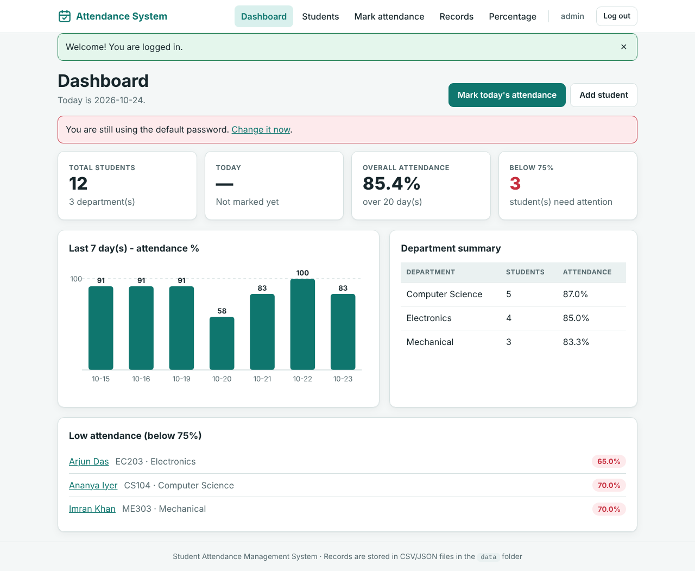

# Student Attendance Management System

A complete college project: an admin logs in, registers students, marks daily attendance
(Present / Absent), views date-wise records, sees every student's attendance percentage,
searches students and exports reports to CSV.

* **Backend:** Python 3 + Flask (single file: `app.py`)
* **Frontend:** HTML, CSS, JavaScript (no frameworks, no internet needed to run)
* **Storage:** local files only - `students.csv`, `attendance.csv` and `admin.json` in the `data/` folder
* **No Firebase, MongoDB, MySQL, PostgreSQL or any database server is used.**



---

## 1. Features

| # | Feature | Where to find it |
|---|---------|------------------|
| 1 | Admin login / logout / change password | `/login`, top-right menu |
| 2 | Add, edit, delete, view student details | **Students** page |
| 3 | Mark daily attendance (Present / Absent) | **Mark attendance** page |
| 4 | Date-wise attendance records with filters | **Records** page |
| 5 | Attendance percentage of every student | **Percentage** page, **Students** list |
| 6 | Search students by name or register number | **Students**, **Records**, **Percentage** pages |
| 7 | Export reports to CSV | **Export** buttons (students / records / percentage) |
| 8 | Dashboard statistics + chart | **Dashboard** |
| 9 | Form validation and friendly error handling | every form |
| 10 | Responsive layout (phone, tablet, desktop, dark mode) | all pages |

**How the percentage is calculated:** `attendance % = present days / recorded days x 100`.
Students below **75 %** are highlighted (change the limit with `LOW_ATTENDANCE_THRESHOLD`).

---

## 2. Requirements

* Windows 10 / 11 (also works on macOS / Linux)
* **Python 3.10 or newer** - download from <https://www.python.org/downloads/>
  and **tick "Add python.exe to PATH"** on the first installer screen.
* A web browser (Chrome, Edge, Firefox)
* Internet only for the first run (to download Flask)

Check Python: open *Command Prompt* and type `python --version`.

---

## 3. Installation and running on Windows

### Easiest way - one double-click
1. Extract the ZIP file (right-click -> *Extract All...*).
2. Open the extracted folder and **double-click `run_windows.bat`**.
3. The first time it creates a virtual environment and installs Flask (about a minute).
4. Your browser opens at <http://127.0.0.1:5000>. If it does not, open that address yourself.
5. Log in with **username `admin`** and **password `admin123`**, then change the password
   (click your name `admin` in the top bar).

Keep the black window open while you use the app. Close it (or press `CTRL+C`) to stop.

### Manual way (Command Prompt)
```bat
cd path\to\student-attendance-system
python -m venv venv
venv\Scripts\activate
pip install -r requirements.txt
python app.py
```
Then open <http://127.0.0.1:5000>.

### macOS / Linux
```bash
cd student-attendance-system
python3 -m venv venv
source venv/bin/activate
pip install -r requirements.txt
python app.py
```

---

## 4. Sample data

The project already contains **12 sample students** (3 departments) and **20 days of attendance**
in the `data/` folder, so every page has something to show (three students are deliberately below 75 % to demonstrate the warnings).

* To start with an **empty** system: delete the two files `data/students.csv` and `data/attendance.csv`
  (the app recreates them empty on the next start), or delete students from the Students page.
* To **restore** the sample data later: double-click `reset_sample_data.bat`
  (or run `python scripts/generate_sample_data.py --reset`). It asks for confirmation first.

---

## 5. Project structure

```
student-attendance-system/
├── app.py                    # the whole Flask application (routes, storage, validation, CSV export)
├── requirements.txt          # Flask
├── README.md                 # this file
├── PROJECT_REPORT.md         # full project report (also docs/PROJECT_REPORT.docx)
├── TEST_CASES.md             # manual + automated test cases
├── run_windows.bat           # double-click to install and start
├── run_tests.bat             # double-click to run the automated tests
├── reset_sample_data.bat     # double-click to restore the sample data
├── templates/                # HTML pages (Jinja2)
│   ├── base.html  login.html  dashboard.html
│   ├── students.html  student_form.html  student_view.html
│   ├── attendance.html  records.html  percentage.html
│   └── change_password.html  error.html
├── static/
│   ├── css/style.css         # responsive stylesheet
│   ├── js/script.js          # menu, confirmations, attendance page helpers
│   └── img/favicon.svg
├── data/                     # all records live here
│   ├── students.csv          # register_no, name, department, year, email, phone, created_at
│   ├── attendance.csv        # date, register_no, status
│   └── admin.json            # admin username + password HASH (created on first run)
├── tests/test_app.py         # 71 automated tests
├── scripts/                  # generate_sample_data.py, capture_screenshots.py
└── docs/                     # ARCHITECTURE.md, diagrams, screenshots, report in Word format
```

---

## 6. How to use and test every feature

Start the app, open <http://127.0.0.1:5000> and follow these steps. Each step says what you should see.
(The full checklist with expected results is in [`TEST_CASES.md`](TEST_CASES.md).)

### Feature 1 - Admin login
1. Open the site. You are sent to the **login** page (nobody can see any page without logging in).
2. Type a wrong password -> red message *"Invalid username or password."*
3. Type `admin` / `admin123` -> the **Dashboard** opens with *"Welcome! You are logged in."*
4. Click **Log out** -> back at the login page. Try opening `/students` directly -> you are sent to login again.
5. Enter a wrong password 5 times -> *"Too many failed attempts"* (locked for 5 minutes).
6. Click **admin** in the top bar -> **Change password**. Enter the current password and a new one
   (8+ characters, at least one letter and one number). Log out and log in with the new password.

### Feature 2 - Add, edit, delete, view students
1. **Students -> + Add student.** Fill register number (e.g. `CS106`), name, department, year, optionally email and phone -> **Add student**. The student appears in the list.
2. Submit the form with a bad e-mail, an empty name or an existing register number -> red validation messages, your typed data stays.
3. Click **View** on a student -> details, present/absent counts, percentage and full attendance history.
4. Click **Edit**, change the name or department -> **Save changes**. (The register number is locked.)
5. Click **Delete** -> a confirmation box appears -> OK. The student *and their attendance records* are removed.

### Feature 3 - Mark daily attendance
1. **Mark attendance.** The date is today; choose a department or leave *All departments*, click **Load**.
2. Everyone starts as **Present**. Click **Absent** for a few students. The counters at the bottom update live.
3. Use **All present** / **All absent** or the filter box to speed things up.
4. Click **Save attendance** -> *"Attendance saved for ... : X present, Y absent."*
5. Load the same date again -> a note says it was already saved; your choices are shown. Change one and save -> it is **updated**, not duplicated.
6. Try a future date -> *"You cannot mark attendance for a future date."*

### Feature 4 - Date-wise records
1. **Records.** You see a summary row per date (present / absent / percentage) and the detailed list.
2. Set **From date** and **To date**, choose a department or status (Present / Absent), click **Apply filters** -> only matching rows remain.
3. Click a date in the summary to open that day in the attendance page.

### Feature 5 - Attendance percentage
1. **Percentage.** Each student shows present, absent, days and a percentage bar (red when below 75 %).
2. Change **Sort by** (lowest first is handy), tick **Only below 75 %**, or set a date range to get the percentage for that period.
3. A student without any records shows **N/A**.

### Feature 6 - Search
1. **Students** page: type part of a name (`pri`) or a register number (`EC2`) -> **Search**. Combine with the department filter. **Clear** resets.
2. The same *Search student* box exists on **Records** and **Percentage**.

### Feature 7 - Export to CSV
1. **Students -> Export CSV** (all students with their percentage).
2. **Records -> Export records CSV** (respects the filters you applied).
3. **Percentage -> Export percentage CSV** (respects the filters).
4. Open the downloaded `.csv` in Excel - names with accents display correctly.

### Feature 8 - Dashboard statistics
Open **Dashboard**: total students, today's attendance, overall percentage, number of students below 75 %,
a bar chart of the last 7 marked days, department summary and the low-attendance list.
Mark today's attendance and refresh to see *Today* change from "Not marked yet" to a percentage.

### Feature 9 - Validation and error handling
* Forms show clear messages and keep what you typed.
* Open `http://127.0.0.1:5000/students/NOPE` -> friendly *404 Not Found* page.
* File in use: open `data\students.csv` in Excel, then try adding a student -> a message tells you to close the file in Excel (nothing is lost).

### Feature 10 - Responsive design
Make the browser window narrow (or press `F12` -> device toolbar). The menu becomes a button, tables turn into cards and the attendance buttons stay easy to tap.

---

## 7. Automated tests

Double-click **`run_tests.bat`**, or:
```bat
venv\Scripts\activate
python -m unittest discover -s tests -v
```
Expected last lines: `Ran 71 tests ... OK`. The tests use a temporary folder, so your data is never changed.
They cover login, lock-out, CSRF, student add / edit / delete / search, attendance marking and updating,
percentage maths, filters, CSV export, dashboard, error pages and file handling.

---

## 8. Configuration (optional)

Set environment variables before starting (Command Prompt example: `set PORT=5001`).

| Variable | Default | Meaning |
|----------|---------|---------|
| `PORT` / `HOST` | `5000` / `127.0.0.1` | Address of the server |
| `DATA_DIR` | `data` | Folder for the CSV/JSON files |
| `LOW_ATTENDANCE_THRESHOLD` | `75` | Percentage under which a student is highlighted |
| `LOGIN_MAX_ATTEMPTS` / `LOGIN_LOCK_SECONDS` | `5` / `300` | Brute-force protection |
| `SECRET_KEY` | auto-generated in `data/.secret_key` | Signs the login cookie |

---

## 9. Troubleshooting

| Problem | Solution |
|---------|----------|
| *"Python is not installed or not in PATH"* | Reinstall Python and tick **Add python.exe to PATH**; restart the window |
| *Port 5000 already in use* | `set PORT=5001` then start again, and open `http://127.0.0.1:5001` |
| *Installing packages failed* | Check the internet connection and run `run_windows.bat` again |
| Page says *"Could not save 'students.csv'..."* | The file is open in Excel - close Excel and retry |
| *Forgot the admin password* | Stop the app, delete `data\admin.json`, start again -> login is `admin` / `admin123` again |
| Browser shows an old page | Press `CTRL+F5` |
| Want a clean start | Delete everything inside `data\` except `.gitkeep` (a new admin file is created automatically) |

## 10. Security notes

Passwords are stored only as salted hashes; every page needs login; forms carry CSRF tokens;
sessions expire after 4 hours; exported CSV cells starting with `= + - @` are neutralised
(spreadsheet formula injection). The built-in server is meant for a college lab or demo -
for a public deployment put the app behind a production server and HTTPS, and change the default password.

## 11. Limitations

CSV files suit a few thousand students; there is a single admin; Late/Leave statuses and
e-mail notifications are not included (see *Future enhancements* in `PROJECT_REPORT.md`).
