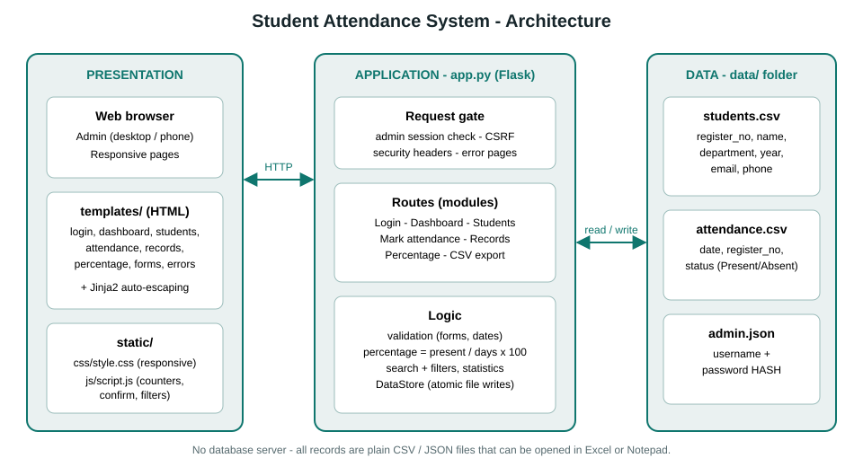
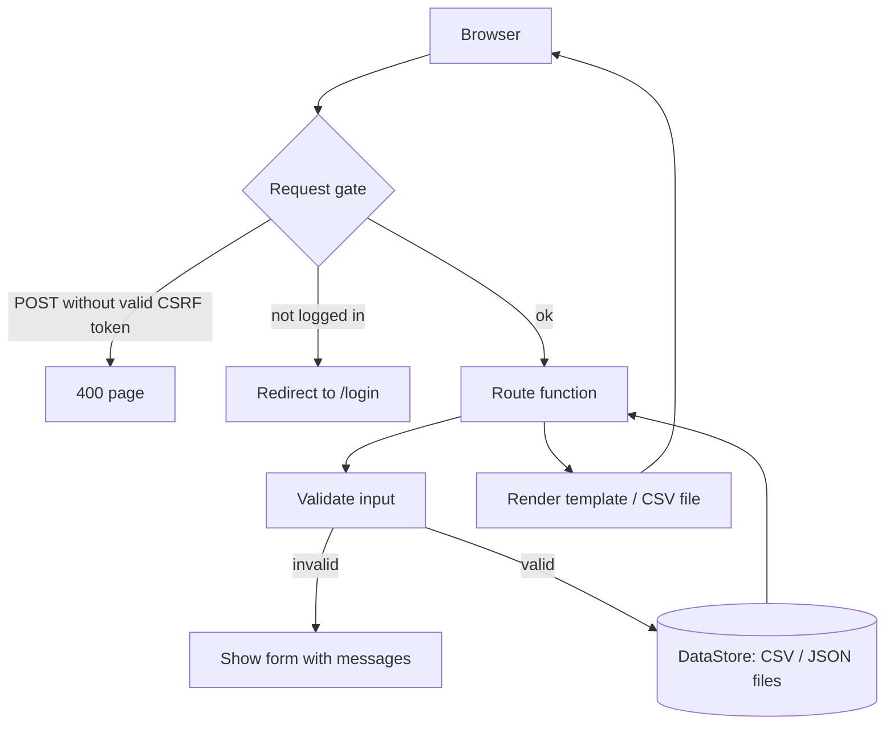
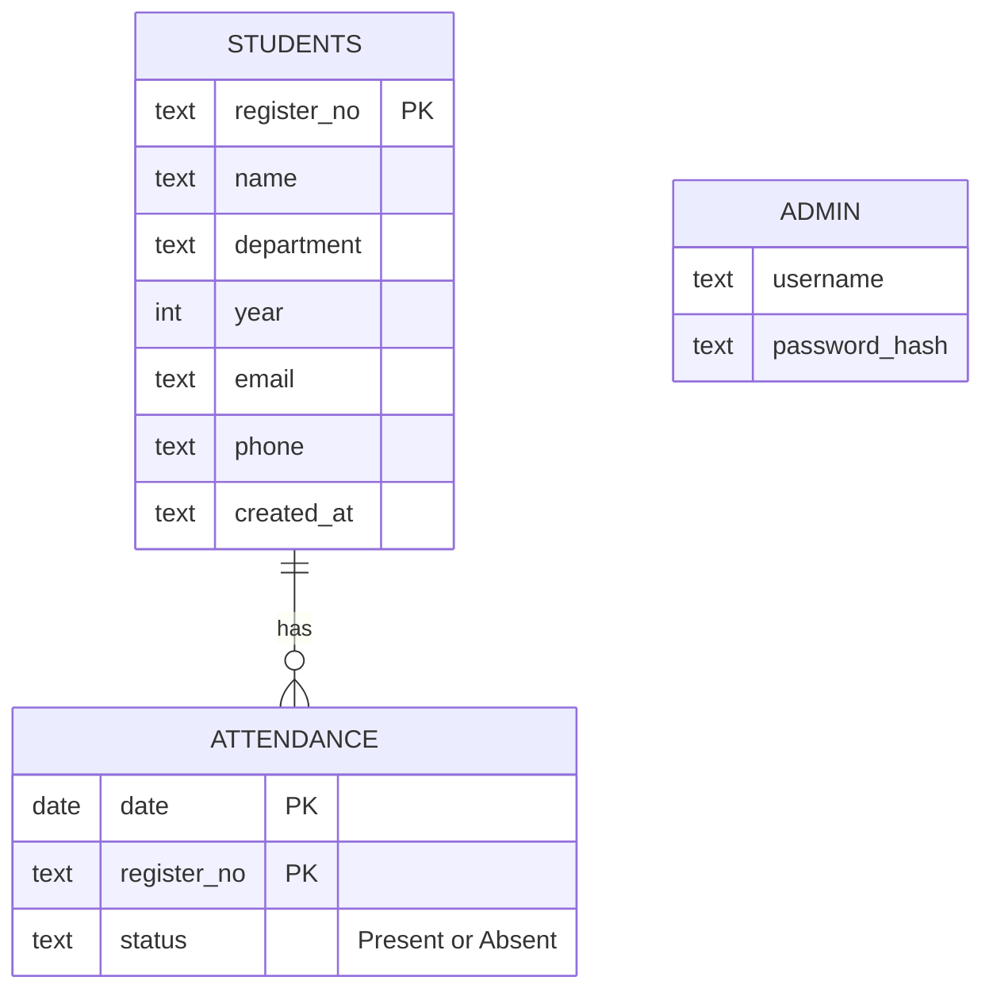
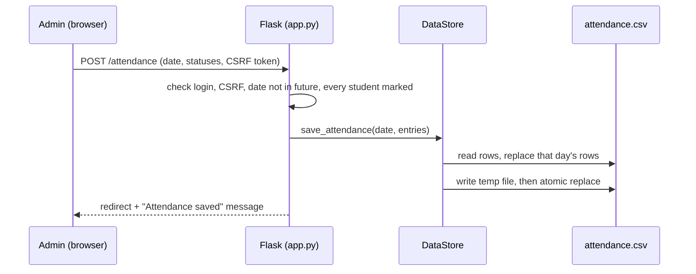

# Architecture

## Layers

| Layer | Files | Responsibility |
|-------|-------|----------------|
| Presentation | `templates/*.html`, `static/css/style.css`, `static/js/script.js` | Pages, responsive layout, small helpers (counters, filters, confirmations) |
| Application | `app.py` | Login gate, CSRF, routes, validation, percentage maths, reports, CSV export, error pages |
| Data | `data/students.csv`, `data/attendance.csv`, `data/admin.json` | Persistent records (atomic writes protected by a lock) |

## Request flow

## Data model

## Saving attendance (sequence)

